# Sledge Review

Sledge Review is an Expo Android app for reviewing invoices, purchase orders, receipts, and change orders from a construction site.
Import a PDF, photograph, or text file, compare copies, and resolve field-level exceptions with source evidence.

## Screenshots

Captured from the Android emulator.

| Review desk | Import a document | Import a change order |
| --- | --- | --- |
| 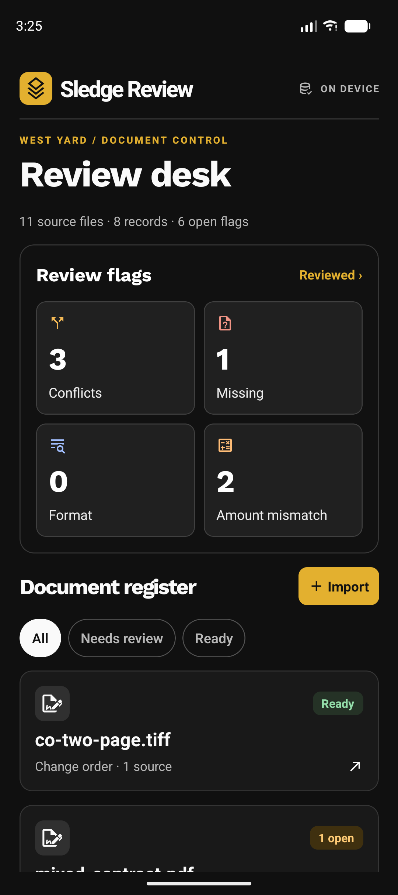 | 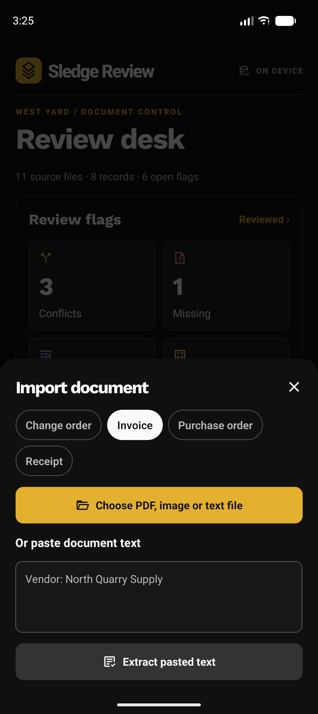 | 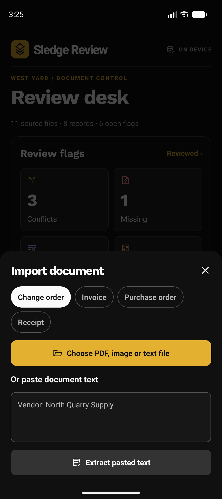 |

| Conflicts queue | Resolve a conflicting total | Invoice field review |
| --- | --- | --- |
| 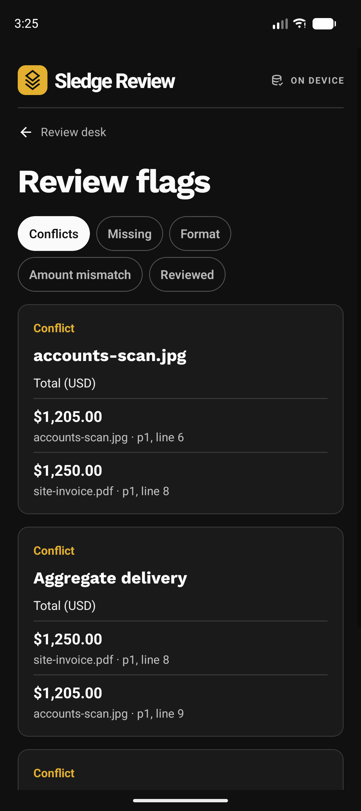 | 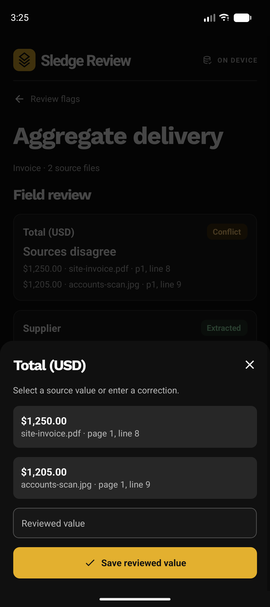 | 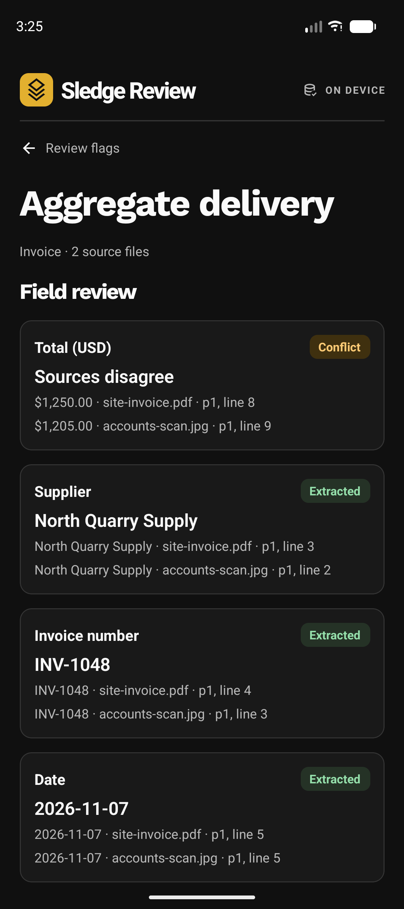 |

| Invoice sources | Attach another copy | Extracted PDF text |
| --- | --- | --- |
| 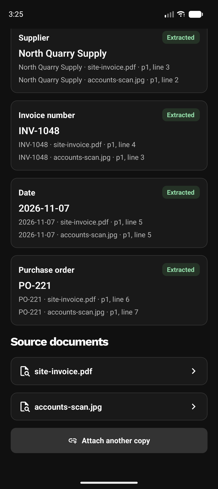 | 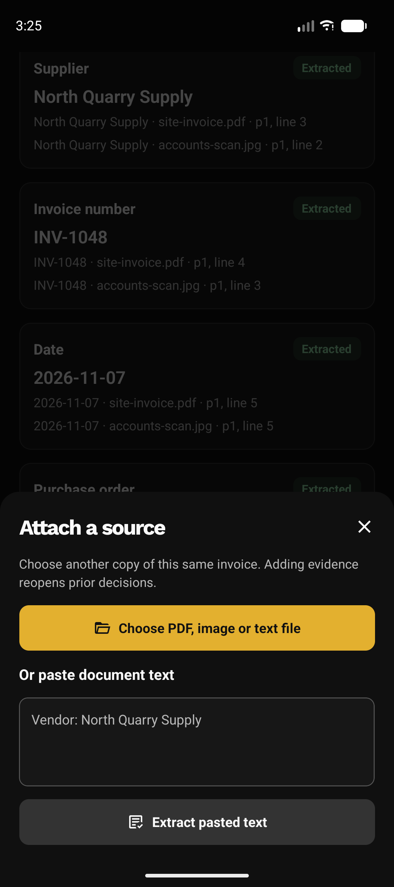 | 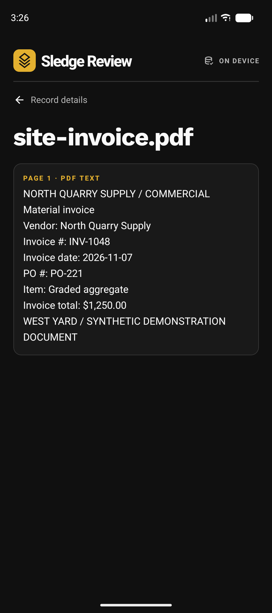 |

| Missing values queue | Resolve a missing value | Format queue |
| --- | --- | --- |
| 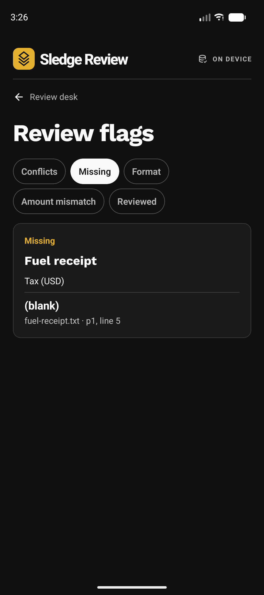 | 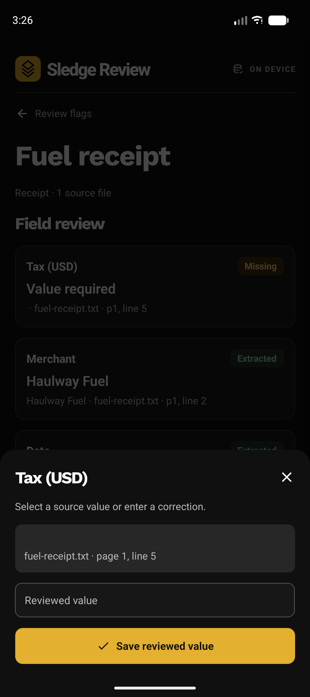 | 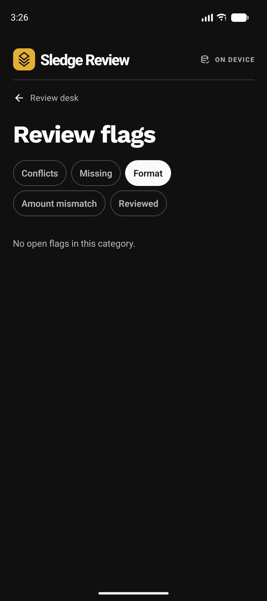 |

| Amount mismatch queue | Resolve an amount mismatch | Reviewed queue |
| --- | --- | --- |
| 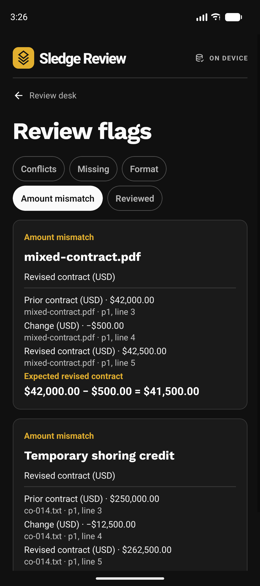 | 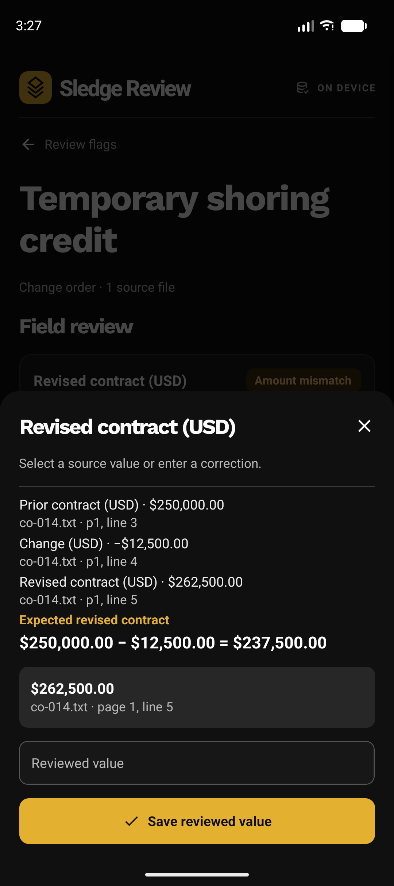 | 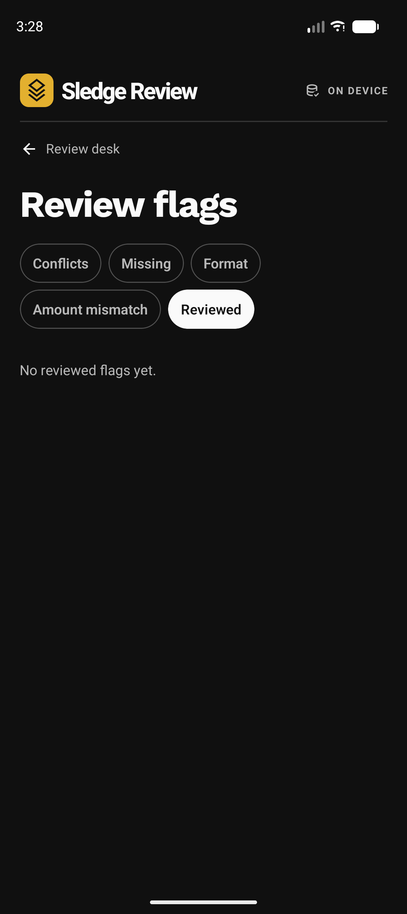 |

## Docs

- [Assignment implementation](docs/sledge-assignment-implementation.pdf) explains how the assignment was implemented.
- [Sample documents](docs/sample-documents/) holds all of the sample test documents (3 PDFs, 1 scanned image, and 4 text files).

## Run on Android

Use Node 22 LTS, JDK 17, the Android SDK, and a running ARM64 Android emulator or USB device.
Sledge Review includes a native ExecuTorch module and requires its own Expo Android build.

```sh
npm ci
npm run android:demo
```

The first build downloads native dependencies and installs the app.
Metro supplies JavaScript during development.
The PP-OCRv6 Small model and character set ship inside the app and work offline.
A release build embeds the JavaScript as well.
Build and install the standalone demo with `npm run android -- --variant release`.

## Try the assignment

1. From **Review desk**, tap **Conflicts** in the **Review flags** panel and open **Aggregate delivery**.
   The invoice PDF says $1,250.00 and the accounts scan says $1,205.00.
   Choose one citation or enter a corrected amount and save it.
2. Switch to **Missing** and open **Fuel receipt** to inspect the absent tax.
   A blank remains unresolved until the reviewer supplies a value.
3. Filter by **Ready** to see the complete purchase order.
4. Use **Import** to create a record and select its document type.
   Use **Attach another copy** inside a record to compare evidence for the same transaction.
5. Open any source under **Source documents** to inspect its extracted page text.

Open **Reviewed** to inspect prior decisions, including both original values for resolved conflicts.
On a fresh install, the **Conflicts** queue contains both **Aggregate delivery** and **Rebar delivery**.

Tap **Review flags → Amount mismatch → Temporary shoring credit** to inspect a change order with an inconsistent revised total.

The seven source files in [fixtures](fixtures/) are synthetic.
To make them available in the Android file picker, run `adb push fixtures/. /sdcard/Download/fielddesk/` and browse Downloads.
The app extracts embedded PDF text locally and runs ExecuTorch on scan pixels, including the image portion of mixed PDFs.
Evidence identifies the source file, page, line, and reading method.
Records, extracted text, and review decisions persist locally across launches.

## Verify

The headless CLI and test corpus use Python 3.11+ and Tesseract with English data.
On macOS, install Tesseract with `brew install tesseract`.

```sh
python3 -m venv .venv
.venv/bin/pip install -r service/requirements.txt
npm test
npm run evaluate
npm run evaluate:corpus
npm run --silent extract > packet-report.json
```

The extraction command reads the original files listed in `fixtures/manifest.json` and writes a JSON report with field values, evidence, and flags.
Use `npm run --silent extract -- /path/to/manifest.json` to process another grouped packet.

The field tests cover all four schemas, every label and format variant, source conflicts, missing and invalid values, normalization, change-order arithmetic, reviewer corrections, and duplicate attachments.
Reader tests exercise PDF text, image OCR, sideways and tilted photographs, multipage scans, transparent images, text encodings, scanned-PDF fallback, and empty, damaged, locked, or unsupported files.
The end-to-end corpus in `evaluation/corpus` holds 32 generated documents with hand-written expected outcomes.
Regenerate it with `npm run corpus:build`, which is deterministic and needs no extra packages.
Mobile import tests also cover conflicting OCR and embedded readings, page order, blank scans, and cleanup on inference errors.

With the emulator connected, run the native multipage TIFF regression after generating the Android project.

```sh
(cd android && ./gradlew :fielddesk-reader:connectedDebugAndroidTest)
```

For a mixed PDF demo, import `evaluation/ocr/mixed-contract.pdf` as a change order.
The native layer supplies $42,000, the scanned section supplies a $500 deduction, and the printed $42,500 triggers **Amount mismatch**.
The [Android screenshot](screenshots/android-mixed-pdf-ocr.png) shows the calculated $41,500 and all three citations.

The [sample JSON report](fixtures/sample-report.json) contains the full extracted results for the bundled documents.

See [System design](SYSTEM-DESIGN.md) for the data flow and scope.

The [OCR benchmark](evaluation/ocr/README.md) compares Tesseract with an actual Android ExecuTorch run on eight synthetic change-order scans.
Both pipelines matched all 23 printed amounts and produced exactly the expected flags on all eight documents.
